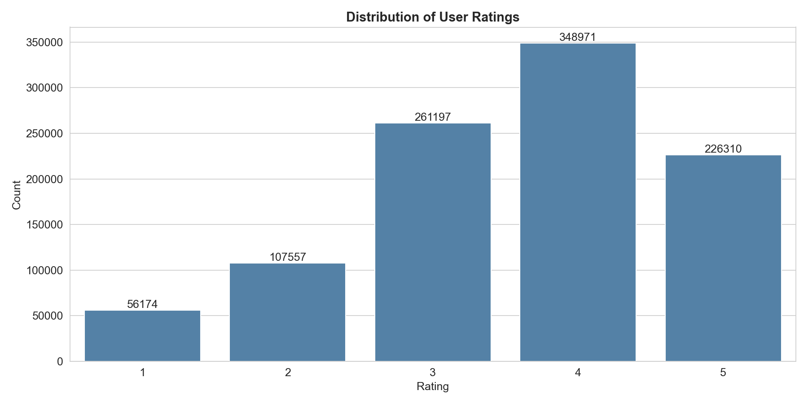
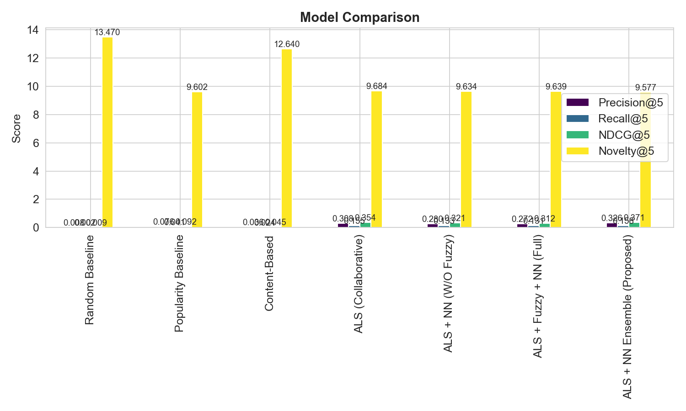
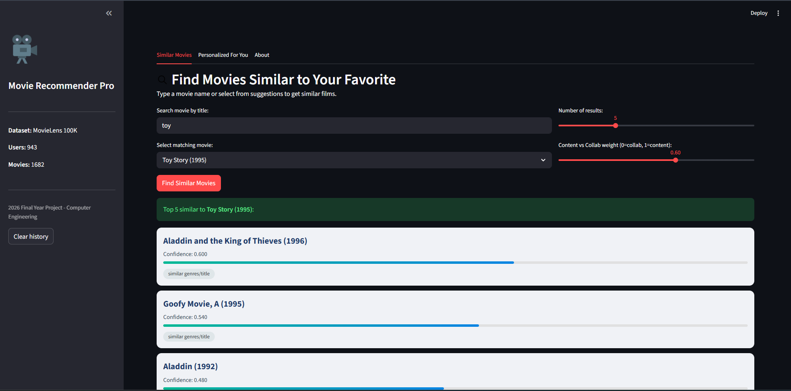

# 🎬 Movie Recommender System with Fuzzy C-Means

> **An Advanced Hybrid Movie Recommendation System Combining Collaborative Filtering, Content-Based Filtering, Fuzzy C-Means Clustering, Neural Networks, and Ensemble Learning**

[](https://www.python.org/)
[](https://streamlit.io/)
[](https://pytorch.org/)
[](https://scikit-learn.org/)
[](LICENSE)

---

# 📌 Overview

**Movie Recommender System with Fuzzy C-Means** is an advanced hybrid recommendation system developed as a Computer Engineering project.

The system combines multiple recommendation approaches to explore whether **fuzzy clustering information extracted from collaborative latent representations** can contribute to recommendation quality.

The project integrates:

- 🎯 **Collaborative Filtering** using ALS
- 🎬 **Content-Based Filtering** using movie genres and TF-IDF title features
- 🧩 **Fuzzy C-Means Clustering** on ALS item latent factors
- 🧠 **Neural Hybrid Recommendation** using collaborative and fuzzy features
- 🔀 **Ensemble Learning** combining ALS and neural predictions
- 📊 Comprehensive recommendation evaluation
- 🖥️ Interactive **Streamlit** interface
- 🎨 Local movie poster support

The final ensemble model achieved the strongest overall ranking performance among the evaluated approaches.

---

# 🏗️ System Architecture

```text
                         ┌─────────────────────────┐
                         │    MovieLens 1M Data    │
                         │                         │
                         │ Users • Movies • Ratings│
                         └────────────┬────────────┘
                                      │
                                      ▼
                         ┌─────────────────────────┐
                         │   Data Preprocessing    │
                         │     & Cleaning          │
                         └────────────┬────────────┘
                                      │
                    ┌─────────────────┴─────────────────┐
                    │                                   │
                    ▼                                   ▼
        ┌──────────────────────┐            ┌──────────────────────┐
        │ Content-Based Model  │            │ Collaborative Model  │
        │                      │            │        ALS           │
        │ Genres + TF-IDF      │            │                      │
        └──────────────────────┘            └──────────┬───────────┘
                                                        │
                                     ┌──────────────────┴──────────────────┐
                                     │                                     │
                                     ▼                                     ▼
                       ┌────────────────────────┐          ┌────────────────────────┐
                       │  ALS User / Item       │          │  Fuzzy C-Means         │
                       │  Latent Factors        │          │  Item Clustering       │
                       └────────────┬───────────┘          └────────────┬───────────┘
                                    │                                   │
                                    └───────────────┬───────────────────┘
                                                    │
                                                    ▼
                                   ┌─────────────────────────────┐
                                   │   Neural Hybrid Recommender │
                                   │                             │
                                   │ • User Embeddings           │
                                   │ • Item Embeddings           │
                                   │ • Interaction Features      │
                                   │ • Fuzzy Membership Vector   │
                                   └──────────────┬──────────────┘
                                                  │
                                                  ▼
                                   ┌─────────────────────────────┐
                                   │      Final Ensemble         │
                                   │                             │
                                   │  0.7 × ALS + 0.3 × Neural   │
                                   └──────────────┬──────────────┘
                                                  │
                                                  ▼
                                   ┌─────────────────────────────┐
                                   │   Movie Recommendations     │
                                   │                             │
                                   │ Streamlit Interactive UI    │
                                   └─────────────────────────────┘
```

---

# 🚀 Key Features

## 🎯 Hybrid Recommendation

The project combines multiple recommendation techniques instead of relying on a single model:

- Content-Based Filtering
- ALS Collaborative Filtering
- Fuzzy C-Means Clustering
- Neural Hybrid Recommendation
- Ensemble Learning

This architecture allows the project to compare different recommendation strategies and investigate the contribution of fuzzy information.

---

## 🎬 Content-Based Filtering

The content-based recommender uses movie metadata to identify similar movies.

Features include:

- Movie genres
- Movie title text
- TF-IDF vectorization
- Similarity-based ranking

This model is especially useful when recommending movies similar to a selected title.

---

## 👥 Collaborative Filtering with ALS

The collaborative model learns latent user and movie representations from rating behavior.

The system uses:

- Alternating Least Squares (ALS)
- User latent factors
- Item latent factors
- Implicit feedback confidence weighting

ALS provides the strongest standalone recommendation performance among the primary individual recommendation models.

---

## 🧩 Fuzzy C-Means Clustering

A major component of the project is the application of **Fuzzy C-Means (FCM)** to ALS item latent factors.

Unlike traditional clustering, Fuzzy C-Means allows every movie to belong to multiple clusters simultaneously.

For each movie:

```text
Movie → Cluster 0: 0.12
      → Cluster 1: 0.58
      → Cluster 2: 0.21
      → Cluster 3: 0.09
```

Instead of assigning a movie to only one cluster, the model produces a **membership vector** representing its degree of membership across all clusters.

This allows the system to identify:

- Strong cluster memberships
- Mixed movies
- Borderline movies
- Soft relationships between movie groups

---

## 🧠 Neural Hybrid Recommender

The neural recommendation model combines multiple learned features.

### Inputs

The neural model receives:

- ALS user latent vector
- ALS item latent vector
- User-item interaction features
- Fuzzy membership vector of the movie

Conceptually:

```text
User Embedding
       +
Item Embedding
       +
Interaction Features
       +
Fuzzy Membership Features
       ↓
Neural Network
       ↓
Recommendation Score
```

The model is trained using fuzzy-aware features to investigate whether soft cluster information can improve personalized recommendations.

---

# 🔀 Final Ensemble Model

The final recommendation model combines the strengths of ALS and the neural model.

```text
Final Score =
0.7 × Normalized ALS Score
+
0.3 × Normalized Neural Score
```

The ensemble preserves the strong ranking capability of ALS while incorporating additional information learned by the neural model.

This approach produced the strongest overall ranking performance in the final evaluation.

---

# 📊 Evaluation Results

The models were evaluated using a hold-out test strategy with a relevance threshold of:

```text
Rating ≥ 3.5
```

## 🎯 Top-K Recommendation Results

| Model | Precision@5 | Recall@5 | NDCG@5 | Precision@10 | Recall@10 | NDCG@10 |
|---|---:|---:|---:|---:|---:|---:|
| Random Baseline | 0.004 | 0.001 | 0.005 | 0.004 | 0.002 | 0.005 |
| Popularity Baseline | 0.055 | 0.020 | 0.050 | 0.050 | 0.035 | 0.052 |
| Content-Based | 0.036 | 0.014 | 0.038 | 0.032 | 0.023 | 0.037 |
| ALS Collaborative | 0.308 | **0.155** | 0.350 | 0.256 | 0.220 | 0.338 |
| ALS + Neural (Without Fuzzy) | 0.268 | 0.136 | 0.307 | 0.228 | 0.186 | 0.298 |
| ALS + Fuzzy + Neural | 0.282 | 0.137 | 0.318 | 0.227 | 0.179 | 0.296 |
| 🏆 **Final ALS + Neural Ensemble** | **0.322** | 0.153 | **0.364** | **0.270** | **0.222** | **0.351** |

---

## 🏆 Best Model

The final ensemble achieved the strongest overall ranking performance.

### Precision@5

```text
ALS:       0.308
Ensemble:  0.322
```

### NDCG@5

```text
ALS:       0.350
Ensemble:  0.364
```

### Precision@10

```text
ALS:       0.256
Ensemble:  0.270
```

### NDCG@10

```text
ALS:       0.338
Ensemble:  0.351
```

These results show that the ensemble improves several key ranking metrics compared with standalone ALS.

> The neural model alone does not outperform ALS. The strongest results are obtained by using neural predictions as part of an ensemble with the collaborative model.

---

# 📏 Evaluation Metrics

The project evaluates recommendation quality using multiple metrics.

### Precision@K

Measures the proportion of recommended movies that are relevant.

```text
Precision@K =
Relevant Recommended Items
──────────────────────────
Total Recommended Items
```

### Recall@K

Measures how many relevant items are successfully retrieved.

### NDCG@K

Measures ranking quality while giving higher importance to relevant movies appearing near the top of the recommendation list.

### Coverage

Measures how much of the available movie catalog can be recommended.

### Novelty

Measures whether recommendations are less dominated by highly popular items.

### Diversity

Measures how different the recommended movies are from one another.

---

# 🎨 Interactive Streamlit Application

The project includes a fully interactive Streamlit interface.

## 🔍 Similar Movies

Users can:

1. Search for a movie.
2. Select the desired title.
3. Adjust the content/collaborative weight.
4. Receive similar movie recommendations.

---

## 👤 Personalized Recommendations

Users can provide:

- A MovieLens user ID
- A favorite movie
- Number of recommendations
- Content vs collaborative weighting

The system then generates personalized recommendations.

---

## 🎲 Surprise Me

The application can randomly select a highly rated movie from the dataset and use it as a starting point for recommendations.

---

## 🧊 Cold-Start Handling

For users without sufficient rating history, the system falls back to popularity-based recommendations using Bayesian average scoring.

This prevents the system from failing when collaborative information is unavailable.

---

## 🧩 Fuzzy Cluster Explorer

The Streamlit application includes a dedicated Fuzzy Clusters section.

Users can explore:

- Number of clusters
- Top movies in each cluster
- Membership values
- Borderline movies
- Mixed-cluster examples

This makes the fuzzy clustering results directly visible and interpretable.

---

## 🖼️ Local Poster Gallery

Movie posters are stored locally and displayed inside recommendation cards.

Each recommendation can show:

- Movie poster
- Title
- Release year
- Genres
- Recommendation confidence
- Recommendation reasons
- Fuzzy cluster membership

---

# 🧪 Fuzzy Clustering Examples

## Top Movies per Cluster

The application displays movies with the strongest membership in each fuzzy cluster.

Example:

| Movie | Membership |
|---|---:|
| Fright Night Part II (1989) | 0.999 |
| Prom Night (1980) | 0.999 |
| Howling II: Your Sister Is a Werewolf (1985) | 0.999 |

---

## Borderline / Mixed Movies

One of the advantages of fuzzy clustering is identifying movies that strongly belong to multiple groups.

Example:

| Movie | Top Cluster | Top Membership | Second Cluster | Second Membership | Difference |
|---|---|---:|---|---:|---:|
| Bonnie and Clyde (1967) | Cluster 1 | 0.221 | Cluster 4 | 0.221 | 0.000 |
| Rumble in the Bronx (1995) | Cluster 2 | 0.235 | Cluster 4 | 0.235 | 0.000 |
| Gone with the Wind (1939) | Cluster 4 | 0.220 | Cluster 0 | 0.219 | 0.001 |

Movies with smaller membership differences are considered more ambiguous or mixed.

---

# 📂 Project Structure

```text
MovieRecommender/
│
├── data/                     # Auto-created dataset folder
│
├── assets/
│   └── posters/              # Local movie posters
│
├── models/                   # Saved trained models
│
├── logs/                     # Execution logs
│
├── reports/
│   └── figures/              # EDA and comparison plots
│
├── pictures/                 # Icons and screenshots
│
├── src/
│   ├── data_loader.py        # Data loading and preprocessing
│   ├── content_based.py      # Content-based recommender
│   ├── collaborative.py      # ALS collaborative recommender
│   ├── fuzzy_clustering.py   # Fuzzy C-Means clustering
│   ├── neural_hybrid.py      # Neural hybrid recommender
│   ├── baseline.py           # Popular / Random baselines
│   ├── hybrid.py             # Hybrid combination engine
│   ├── evaluation.py         # Metrics and evaluation
│   ├── visualization.py      # Plots and charts
│   └── utils.py              # Utilities and helper functions
│
├── app/
│   └── streamlit_app.py      # Interactive Streamlit UI
│
├── config.py                 # Hyperparameters and configuration
├── main.py                   # Full training pipeline
├── ablation_study.py         # Model comparison and fuzzy analysis
├── download_posters.py       # Poster downloader
├── requirements.txt          # Python dependencies
├── .gitignore
└── README.md
```

---

# 📊 Dataset

The project uses the **MovieLens 1M Dataset**.

### Dataset Statistics

| Item | Count |
|---|---:|
| Ratings | 1,000,209 |
| Users | 6,040 |
| Movies | 3,952 |
| Rating Scale | 1–5 |

Movie metadata includes:

- Movie ID
- Title
- Release year
- Genre information

The content-based model uses movie genres and title information, while collaborative models learn from user rating behavior.

---

# ⚙️ Installation

## 1️⃣ Clone the Repository

```bash
git clone https://github.com/HamidNova/movie-recommendation-system.git
cd movie-recommendation-system
```

---

## 2️⃣ Create a Virtual Environment

```bash
python -m venv .venv
```

### Windows

```bash
.venv\Scripts\activate
```

### Linux / macOS

```bash
source .venv/bin/activate
```

---

## 3️⃣ Install Dependencies

```bash
pip install -r requirements.txt
```

---

# 🧠 Run the Training Pipeline

The main training pipeline:

```bash
python main.py
```

The pipeline performs the major stages of the project workflow, including:

- Data loading
- Preprocessing
- Content-based model preparation
- ALS collaborative training
- Fuzzy C-Means clustering
- Neural hybrid training
- Model evaluation
- Saving trained models

---

# 🧪 Run the Ablation Study

To compare the different recommendation approaches:

```bash
python ablation_study.py
```

The ablation study compares approaches such as:

- Random baseline
- Popularity baseline
- Content-based filtering
- ALS collaborative filtering
- Neural recommendation without fuzzy features
- Fuzzy-aware neural recommendation
- Final ensemble model

---

# 🖼️ Download Movie Posters

The project includes a utility for downloading missing movie posters:

```bash
python download_posters.py
```

The script:

1. Searches for movie posters.
2. Downloads valid poster images.
3. Stores them locally using the movie ID.
4. Generates a placeholder poster if a suitable image cannot be found.

Poster files are stored in:

```text
assets/posters/
```

---

# 🖥️ Run the Streamlit Application

Launch the interactive application:

```bash
streamlit run app/streamlit_app.py
```

Then open:

```text
http://localhost:8501
```

---

# 📸 Screenshots

## Rating Distribution



## Model Comparison



## Streamlit Application



---

# 🧰 Technology Stack

## Programming

- Python

## Data Processing

- Pandas
- NumPy

## Machine Learning

- Scikit-learn
- Implicit ALS

## Fuzzy Clustering

- scikit-fuzzy

## Deep Learning

- PyTorch

## Data Visualization

- Matplotlib

## Web Application

- Streamlit

## Poster Collection

- DuckDuckGo Search
- Requests
- Pillow

---

# 🔬 Research Focus

The main research question explored in this project is:

> **Can fuzzy membership information extracted from collaborative item embeddings contribute useful information to a hybrid movie recommendation system?**

The project investigates this question through:

- Fuzzy clustering of ALS item representations
- Neural models using fuzzy membership vectors
- Fuzzy-aware training experiments
- Ablation studies
- Final ensemble evaluation

The experiments show that the neural model alone does not outperform ALS, but combining neural predictions with ALS through an ensemble improves several important ranking metrics.

---

# ⚠️ Limitations

This project has several limitations:

- MovieLens ratings may not fully represent real-world streaming behavior.
- Recommendation performance depends on historical user ratings.
- Fuzzy cluster labels do not represent explicit movie genres.
- Neural models may suffer from regression toward average predictions.
- Evaluation results are dataset-specific.
- Improvements should not automatically be generalized to all recommendation datasets.

---

# 🔮 Future Improvements

Possible future extensions include:

- [ ] Hyperparameter optimization for the neural model
- [ ] Automatic selection of the optimal number of fuzzy clusters
- [ ] Temporal recommendation experiments
- [ ] Movie metadata enrichment
- [ ] Transformer-based recommendation models
- [ ] Explainable AI techniques
- [ ] Docker deployment
- [ ] Automated testing
- [ ] CI/CD integration
- [ ] Online learning from user feedback
- [ ] Larger-scale evaluation on additional datasets

---

# 🎓 Project Purpose

This project was developed as an exploration of:

> **Recommendation Systems + Collaborative Filtering + Fuzzy Logic + Deep Learning + Ensemble Learning**

The goal is to investigate how traditional recommendation algorithms can be extended with soft clustering and neural learning techniques.

---

# 👤 Author

**Hamidreza Mirzaei**

🎓 M.Sc. Student in Artificial Intelligence  
💻 GitHub: https://github.com/HamidNova  
📧 Email: hamidrezamirzaei8363@gmail.com

---

## ⭐ If You Find This Project Interesting

Consider giving the repository a **star** ⭐

Your support helps the project reach more developers and researchers.

---

### 📄 License

This project is available under the **MIT License**.